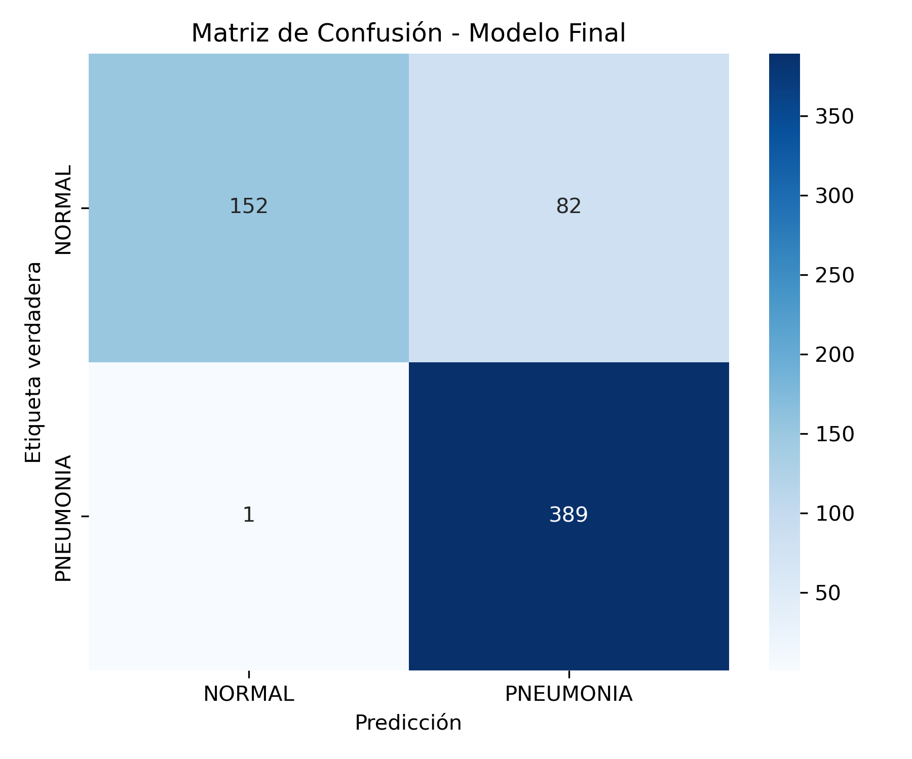
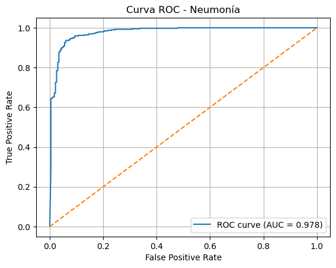

# Pneumonia Detection in Chest X-Rays

Deep-learning project for binary classification of chest X-ray images into **NORMAL** and **PNEUMONIA** using a pretrained **ResNet50** model with progressive fine-tuning.

The project also includes model evaluation through a confusion matrix and ROC curve, as well as interpretability techniques based on Grad-CAM and Grad-CAM++.

## Overview

This project was developed as part of a Machine Learning course in the Telecommunications Engineering program at the University of Concepción.

The main objective was to explore transfer learning and deep-learning techniques for pneumonia detection from chest X-ray images.

A ResNet50 architecture pretrained on ImageNet was adapted for binary classification and trained through a progressive fine-tuning strategy.

## Technologies

- Python
- PyTorch
- Torchvision
- ResNet50
- Transfer Learning
- Fine-Tuning
- Computer Vision
- Deep Learning
- Scikit-learn
- NumPy
- Matplotlib
- Seaborn
- OpenCV
- Grad-CAM
- Grad-CAM++

## Dataset

The dataset contains chest X-ray images organized into two classes:

- `NORMAL`
- `PNEUMONIA`

The original training dataset was divided into training and validation subsets, while the original test dataset was kept separately for final model evaluation.

Dataset sizes used in the project:

- Training: **4,186 images**
- Validation: **1,046 images**
- Test: **624 images**

Images were resized to **224 × 224 pixels** and converted to three channels in order to use the pretrained ResNet50 architecture.

Data augmentation was applied to the training set using:

- Random rotations
- Brightness variation
- Contrast variation
- Random resized crops

ImageNet normalization was used before feeding the images into the network.

## Model

The model is based on **ResNet50 pretrained on ImageNet**.

The original classification layer was replaced with a new fully connected layer containing two output classes:

```text
NORMAL
PNEUMONIA
```

Cross-entropy loss was used as the optimization objective.

## Progressive Fine-Tuning

Training was performed in three stages.

### Phase 1 – Final Classification Layer

Only the final fully connected layer was trained.

- Epochs: 5
- Learning rate: `1e-3`

### Phase 2 – Final Layer + Layer4

The last residual block and the classification layer were trained.

- Epochs: 5
- Learning rate: `1e-4`

### Phase 3 – Full Fine-Tuning

The complete ResNet50 network was unfrozen and fine-tuned.

- Maximum epochs: 10
- Learning rate: `1e-5`

The model with the lowest validation loss was retained as the final model.

## Results

The final model achieved approximately:

| Metric | Result |
|---|---:|
| Test Accuracy | **86.7%** |
| ROC AUC | **0.9781** |
| Pneumonia Recall | **1.00** |

The high ROC AUC indicates strong discrimination between NORMAL and PNEUMONIA chest X-rays.

The model achieved perfect recall for the PNEUMONIA class on the test set, meaning that all pneumonia cases in that test set were detected.

## Confusion Matrix

The confusion matrix provides a detailed view of the classification performance for both classes.



## ROC Curve

The ROC curve evaluates the model's ability to distinguish between NORMAL and PNEUMONIA cases across different classification thresholds.



The resulting ROC AUC was approximately **0.9781**.

## Model Interpretability

Grad-CAM and Grad-CAM++ were explored to visualize the regions of chest X-rays that contributed most strongly to the model's predictions.

These techniques generate activation maps over the original image, providing greater insight into the internal behavior of the convolutional neural network.

Interpretability is particularly relevant in medical-image classification because high classification performance alone does not explain which image regions influence the model.

## Repository Structure

```text
pneumonia-detection-deep-learning/
├── notebooks/
│   └── pneumonia_detection.ipynb
├── images/
│   ├── confusion-matrix.png
│   └── roc-curve.png
├── requirements.txt
├── .gitignore
├── LICENSE
└── README.md
```

## Installation

Clone the repository:

```bash
git clone https://github.com/gaboguti270601/pneumonia-detection-deep-learning.git
cd pneumonia-detection-deep-learning
```

Install the required dependencies:

```bash
pip install -r requirements.txt
```

Then launch Jupyter:

```bash
jupyter notebook
```

Open:

```text
notebooks/pneumonia_detection.ipynb
```

## Dataset Setup

The dataset is not included directly in this repository.

To reproduce the project, place the chest X-ray dataset using the following structure:

```text
Datasets/
└── Pneumonia Detection Dataset/
    └── chest_xray/
        ├── train/
        │   ├── NORMAL/
        │   └── PNEUMONIA/
        └── test/
            ├── NORMAL/
            └── PNEUMONIA/
```

## Project Context

Academic Machine Learning project developed as part of the Telecommunications Engineering curriculum at the University of Concepción.

The project focused on:

- Deep learning
- Transfer learning
- Computer vision
- Medical image classification
- Model evaluation
- Explainable AI
- Grad-CAM visualization

## Author

**Gabriel Gutiérrez Leal**  
Civil Engineer in Telecommunications  
University of Concepción
